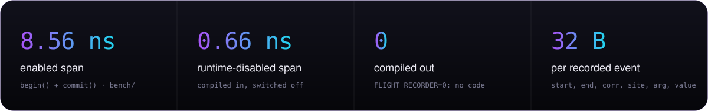
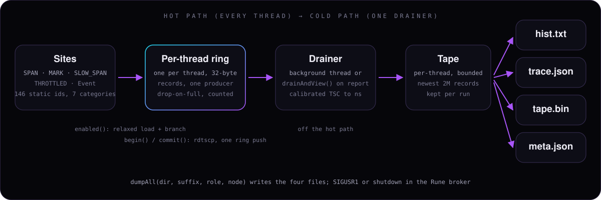

<div align="center">

<a href="https://arcanum.regressorspath.com/rune/">
  
</a>

<br>

[](CMakeLists.txt)
[](include/flight_recorder/Recorder.h)
[](docs/output-formats.md)
[](include/flight_recorder/Event.h)
[](conanfile.py)
[](https://github.com/arcanumruna/rune#readme)

**[Website](https://arcanum.regressorspath.com/rune/)** ·
**[Build](#build)** ·
**[Use it](#consuming-flight-recorder)** ·
**[Testing](#tests)** ·
**[Benchmarks](#benchmarks)** ·
**[Reference](#reference)**

</div>

<br>

flight-recorder answers "what took long?" without ad-hoc A/B benchmarking. An event is *measured*: `begin()` stamps a start
timestamp, `commit()` stamps the end and appends a completed 32-byte record to the calling thread's own ring. A separate,
off-hot-path drainer turns the rings into per-site latency histograms, a Chrome trace timeline and a raw tape. It was written
for [Rune](https://github.com/arcanumruna/rune#readme)'s produce path, where 50 µs matters, and is a small standalone
C++23 library.

<p align="center">
  
</p>

<sub>Measured with Google Benchmark (Release, `-O3`, `--benchmark_min_time=1s`) on an Apple Silicon development machine, from
[`bench/fr_overhead_bench.cpp`](bench/fr_overhead_bench.cpp), see [Overhead](#overhead). Reproduce on your hardware before
you rely on them: the x86_64 path uses `rdtscp`.</sub>

## How it records

<p align="center">
  
</p>

- **Sites.** Every measurement point is a statically declared id (`flight_recorder::Site`, 146 of them in 7
  [categories](docs/sites.md)). The hot path carries only the 16-bit id; names are resolved at report time.
- **Per-thread rings.** Each thread writes only its own ring (the first record registers it). The ring is drop-on-full:
  `commit()` never blocks, and a full ring drops the record and counts the drop.
- **Gating.** Two switches. `FLIGHT_RECORDER=0` at build time compiles every macro to nothing. At run time a master flag and a
  per-category mask decide whether a site records; a disabled site costs one relaxed load and a branch.
- **Drain.** A single drainer (a background thread, or the report call itself) moves committed records into each thread's
  bounded tape, converting timestamps with a calibrated tick rate.
- **Output.** Per-site histograms (p50, p90, p99, p999, max, count, mean in ns), a Chrome trace (`chrome://tracing`, Perfetto,
  speedscope), a versioned raw tape for offline analysis, and run metadata for aligning several processes.

## Requirements

| | |
|---|---|
| **Compiler** | A C++23 compiler (`CMAKE_CXX_STANDARD 23`). CMake does not check the version; the Rune project builds it with GCC 13 and Apple clang 17. |
| **CMake** | 3.31 or newer. |
| **Aeron headers** | Version 1.51.0 (`conandata.yml`). The per-thread ring is a namespace-isolated copy of Aeron's many-to-one ring built on Aeron's **header-only** `AtomicBuffer`, with Aeron's `RecordDescriptor` framing kept in `detail/RecordDescriptor.h`; there is no link-time dependency. |
| **Platform** | Linux and macOS, little-endian. Timestamps: `rdtscp` on x86_64, `cntvct_el0` on arm64, `CLOCK_MONOTONIC_RAW` elsewhere. |
| **Tests and benchmarks** | GTest 1.16.0, Google Benchmark 1.8.2, nlohmann_json 3.12.0 (`test_requirements`). |
| **Conan** | Conan 2, optional. |

The Aeron ConanCenter recipe rejects macOS/arm64, so on Apple Silicon `conanfile.py` skips it and CMake uses a stub target:
configure works, and to compile you point at cached Aeron headers with `-DFLIGHT_RECORDER_AERON_INCLUDE_DIR`.

## Build

Standalone, with Conan:

```bash
conan install . -of build -s build_type=Release -s compiler.cppstd=23 -o flight-recorder/*:flight_recorder=True --build=missing
cmake --preset conan-release -DBUILD_TESTING=ON -DBUILD_BENCHMARKS=ON
cmake --build --preset conan-release -j
ctest --preset conan-release --output-on-failure
```

For a debug cycle use `build_type=Debug` and the `conan-debug` preset. `CMakeUserPresets.json` is generated by Conan and is
not tracked. On macOS/arm64 add the Aeron headers (find them in the Conan cache):

```bash
cmake --preset conan-debug -DBUILD_TESTING=ON \
  -DFLIGHT_RECORDER_AERON_INCLUDE_DIR=$(dirname $(dirname $(find ~/.conan2 -path '*p/include/concurrent/AtomicBuffer.h' | head -1)))
```

Build options:

| Option | Default | Meaning |
|---|---|---|
| `FLIGHT_RECORDER` | `ON` | Compile the recorder in. `OFF` defines `FLIGHT_RECORDER=0` for every consumer: every macro and `Event` compile to nothing. |
| `BUILD_TESTING` | `OFF` | Build `flight_recorder_tests` and `flight_recorder_compileout_test`. |
| `BUILD_BENCHMARKS` | `OFF` | Build `flight_recorder_bench`. |
| `FLIGHT_RECORDER_AERON_INCLUDE_DIR` | empty | Aeron client headers when the `aeron` package is not found (macOS fallback). |

Targets: `flight_recorder::flight_recorder` (headers plus the compiled cold-path library `flight_recorder_core`: calibration,
registry, reports). The version lives in `VERSION.txt` and `include/flight_recorder/Version.h`; CMake refuses to configure when
they differ.

## Consuming flight-recorder

**With Conan.** Add `flight-recorder/0.1.0-snapshot` to your `conandata.yml`, then:

```cmake
find_package(flight_recorder CONFIG REQUIRED)
target_link_libraries(your_target PRIVATE flight_recorder::flight_recorder)
```

`-o flight-recorder/*:flight_recorder=False` compiles the instrumentation out for every consumer.

**With FetchContent or a local checkout.** This is how Rune consumes it: clone the pinned commit (or point at a checkout) and
compile the four source files into your own target, so the recorder is built with your flags. Rune's CMake exposes
`FLIGHT_RECORDER_DIR` for the checkout; empty means fetch.

```cmake
set(FLIGHT_RECORDER_DIR "" CACHE PATH "Local flight-recorder checkout; empty = fetch it")
if(NOT FLIGHT_RECORDER_DIR)
    include(FetchContent)
    FetchContent_Declare(flight_recorder_src
        GIT_REPOSITORY git@github.com:arcanumruna/flight-recorder.git
        GIT_TAG        <pinned commit>
        SOURCE_SUBDIR  _no_cmake_build)          # clone only: we compile the sources ourselves
    FetchContent_MakeAvailable(flight_recorder_src)
    set(FLIGHT_RECORDER_DIR "${flight_recorder_src_SOURCE_DIR}" CACHE PATH "" FORCE)
endif()
add_library(flight_recorder STATIC
    ${FLIGHT_RECORDER_DIR}/src/Calibration.cpp ${FLIGHT_RECORDER_DIR}/src/Enable.cpp
    ${FLIGHT_RECORDER_DIR}/src/Registry.cpp    ${FLIGHT_RECORDER_DIR}/src/Report.cpp)
target_include_directories(flight_recorder PUBLIC ${FLIGHT_RECORDER_DIR}/include)
target_link_libraries(flight_recorder PUBLIC aeron::aeron)           # header-only use of Aeron's buffers
target_compile_features(flight_recorder PUBLIC cxx_std_23)
target_compile_definitions(flight_recorder PUBLIC FLIGHT_RECORDER=1)   # or =0 to compile everything out
```

Pass `-DFLIGHT_RECORDER_DIR=../flight-recorder` for local development. A [minimal consumer](sample) links
`flight_recorder::flight_recorder`, records a few spans, prints histograms and writes a Chrome trace; build it against an
installed copy (`find_package(flight_recorder CONFIG REQUIRED)`).

### A first recording

```cpp
#include <flight_recorder/FlightRecorder.h>
#include <iostream>
using namespace flight_recorder;

int main() {
    configureFromEnv();                         // FLIGHT_RECORDER_ENABLE=1 turns recording on; sizes the rings
    {
        FLIGHT_RECORDER_SPAN_PRODUCE(Site::WorkerAppend, /*corr=*/42);   // scoped span, category Produce
        // ... the work being measured ...
    }
    FLIGHT_RECORDER_MARK_VAL_PRODUCE(Site::ProduceAckSend, 42, /*value=*/3.5);   // an instant with a value

    dumpHistograms(std::cout);                  // per-site p50/p90/p99/p999/max/count/mean
    dumpAll("out", "-run1", "demo", "0");       // fr-hist-run1.txt, fr-trace-run1.json, fr-tape-run1.bin, fr-meta-run1.json
}
```

```text
$ FLIGHT_RECORDER_ENABLE=1 ./demo
site                 count     p50(ns)     p90(ns)     p99(ns)    p999(ns)     max(ns)      mean(ns)
WorkerAppend             1           0           0           0           0           0           0.0
ProduceAckSend           1           0           0           0           0           0           0.0
```

Instrument only through the per-category macros (`FLIGHT_RECORDER_SPAN_PRODUCE`, `..._MARK_REPLICATION`, ...): each is gated by
both the master switch and its category switch. The full API is split into [C++](docs/api/cpp.md) and [C](docs/api/c-api.md).

## Configuration

| Variable | Default | Effect |
|---|---|---|
| `FLIGHT_RECORDER_ENABLE` | off | Set and not `0`: `configureFromEnv()` enables recording. |
| `FLIGHT_RECORDER_RING_BYTES` | `134217728` (128 MiB) | Per-thread ring size. Rounded up to a power of two. |
| `FLIGHT_RECORDER_CATEGORIES` | all | Comma list of `produce`, `replication`, `read`, `consensus`, `storage`, `egress`, `runtime`. |
| `FLIGHT_RECORDER_SLOW_SPAN_NS` | `2000` | A `SlowSpan` shorter than this is not recorded. |
| `FLIGHT_RECORDER_THROTTLE_NS` | `50000` | Minimum gap between marks of one `Throttle`. |
| `FLIGHT_RECORDER_DRAIN_MS` | `100` | Background drain period; `0` = none. |
| `FLIGHT_RECORDER_TAPE_RECORDS_PER_THREAD` | `2097152` | Newest records kept per thread tape. |
| `FLIGHT_RECORDER_AERON_MASK` | `0xC7F0F8` | Which C-API (Aeron driver) sites record. |

Compile-time: `FLIGHT_RECORDER=0|1`, and `-DFLIGHT_RECORDER_NO_PRODUCE`, `..._NO_REPLICATION`, `..._NO_READ`,
`..._NO_CONSENSUS`, `..._NO_STORAGE`, `..._NO_EGRESS`, `..._NO_RUNTIME` to compile one category out. Details:
[docs/configuration.md](docs/configuration.md).

## Reading a recording

| File | What it is | Open it with |
|---|---|---|
| `fr-hist<sfx>.txt` | Per-site histogram table (count and percentiles in ns) | any text viewer |
| `fr-trace<sfx>.json` | Chrome trace events, one `X` event per span | `chrome://tracing`, [Perfetto](https://ui.perfetto.dev), speedscope |
| `fr-tape<sfx>.bin` | Versioned raw tape (`RUNEFR01`), every drained record | `flight_recorder::readTape()` |
| `fr-meta<sfx>.json` | Role, node, pid, host, cross-process anchor, drops, thresholds | any JSON tool |

`printWaterfall(corr, out)` and `stitchByCorr(corr)` reassemble one request across threads by its correlation id. The formats
and the cross-process alignment rule (align on anchor differences with one tick rate, never on absolute timestamps) are in
[docs/output-formats.md](docs/output-formats.md). Rune's `broker/bench/kafka-compare/frwaterfall.py` is an example analyzer.

## Overhead

| Case | ns/op |
|---|---|
| enabled span (`begin()` and `commit()`) | **8.56** |
| enabled mark (instant) | **8.54** |
| runtime-disabled span (compiled in) | **0.66** |
| compiled out (`FLIGHT_RECORDER=0`) | 0 |

The enabled cost is the per-thread ring's uncontended claim, a 32-byte copy and a commit. The design targets (enabled at most
10 ns, disabled at most 1 ns) are met on the development machine. Confirm on x86_64 before relying on the numbers there.

## Tests

```bash
ctest --preset conan-release --output-on-failure             # everything
ctest --preset conan-release -R 'Throughput|M2ORing'         # a slice
```

| Test file | Covers |
|---|---|
| `VersionTest`, `CalibrationTest`, `SitesTest` | Version guard, tick-rate calibration, the site registry (a meta entry for every site, unique non-empty names, categories). |
| `M2ORingTest`, `RegistryTest`, `ThroughputTest` | The ring (round trip, drop-on-full, clamping of odd capacities, no torn record under a concurrent drain), thread registration and reset, multi-thread isolation. |
| `EnableTest`, `EventTest`, `HopInstrumentationTest` | Master and category gating, spans and marks, `SlowSpan`, `Throttle`, correlation keys, drop accounting, the background drainer, the run dump and its meta file, the C API. |
| `HistogramTest`, `ReportHistogramTest`, `ChromeTraceTest`, `TapeTest` | Histogram accuracy (about 0.78% relative error), the per-site report, the trace JSON, the tape format and round trip. |
| `CompileOutTest` | Built with `FLIGHT_RECORDER=0` and linked **only** against GTest, so any leftover reference to a recorder symbol fails to link. |

Sanitizers: configure with `-DCMAKE_CXX_FLAGS="-fsanitize=address,undefined"` or `-fsanitize=thread` (plus the matching
linker flag) and run `ctest`. For ThreadSanitizer use the suppression for Aeron's own ring internals:

```bash
TSAN_OPTIONS="suppressions=$PWD/tests/tsan.supp" ctest --preset conan-debug --output-on-failure
```

## Benchmarks

```bash
cmake --preset conan-release -DBUILD_BENCHMARKS=ON
cmake --build --preset conan-release --target flight_recorder_bench
./build/build/Release/flight_recorder_bench --benchmark_min_time=1s
```

`BM_SpanEnabled`, `BM_SpanDisabled` and `BM_MarkEnabled` report ns per span or mark. Run on an idle machine; the disabled case
should read about a nanosecond. The binary path depends on your Conan output folder.

## Reference

| Document | Covers |
|---|---|
| [docs/api/cpp.md](docs/api/cpp.md) | `Event`, spans, marks, macros, enabling, reports, tapes, correlation keys, threading rules |
| [docs/api/c-api.md](docs/api/c-api.md) | The C interface used by C code such as the Aeron media driver |
| [docs/configuration.md](docs/configuration.md) | Environment variables, compile flags, categories |
| [docs/output-formats.md](docs/output-formats.md) | Histogram, Chrome trace, tape and meta formats; tooling |
| [docs/sites.md](docs/sites.md) | All 146 sites by category |
| [docs/specs/](docs/specs), [docs/superpowers/plans/](docs/superpowers/plans) | The original design spec and implementation plan |

## License and links

No license file is present in this repository, so no license is granted by it; ask the maintainers before reuse.

[Rune](https://github.com/arcanumruna/rune#readme) · [Website](https://arcanum.regressorspath.com/rune/) ·
[Source](https://github.com/arcanumruna/flight-recorder)
